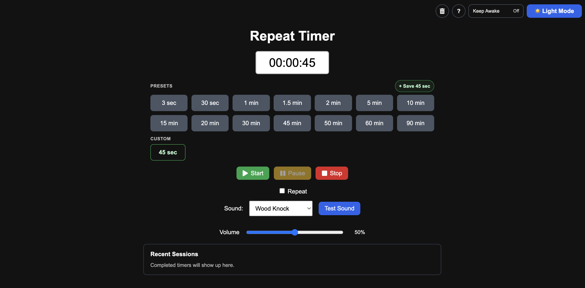

# Repeat Timer App

A customizable repeat timer built with React and TypeScript that plays a sound at the end of each interval. Great for workouts, study blocks, Pomodoros sessions, or any repetitive task.

Inspired by: [https://time-time.net/timer/countdown-timer.php](https://time-time.net/timer/countdown-timer.php)

---
Demo: [https://hahalima.github.io/repeat-timer-app/](https://hahalima.github.io/repeat-timer-app/)



---

## Features

- Set time via editable `HH:MM:SS` text input
- One-click built-in presets, including 3 sec, 30 sec, 1 min, 5 min, 30 min, and more
- Save, edit, reorder, and delete custom time presets
- Start / Pause / Stop buttons with icons
- Repeat mode with customizable repeat count (1–100)
- Choose from ~6 different end-of-interval sounds (with volume control)
- Light/Dark mode toggle (remembers preference via `localStorage`)
- Keep Awake toggle for supported browsers
- Keyboard shortcuts with an in-app shortcut help dialog
- Visual progress bars for current interval and total repeat session
- Recent session history with use-again, per-session delete, and clear controls
- Clear setup control for resetting timer duration, repeats, and custom presets
- Remembers timer settings, custom presets, session history, and theme via `localStorage`
- Shows total duration and time range
- End-of-session popup with friendly “Done” voice and time summary
- Volume slider with tooltip and percent indicator

---

## Tech Stack

- [React](https://reactjs.org/)
- [TypeScript](https://www.typescriptlang.org/)
- [React Icons](https://react-icons.github.io/react-icons/)
- CSS (custom + utility classes)

---

## Installation

**Install dependencies**

	npm install

**Start the development server**

	npm start

Local app: `http://localhost:5160/repeat-timer-app`

---

## Add Custom Sounds

Place your audio files in:

```
/public/sounds/
```

Example filenames:
```
wood-door-knock.mp3
guitar-alert.mp3
gaming-lock.mp3
correct-tone.mp3
magic-ring.mp3
church-bell.mp3
done-woman-voice.mp3
```

Then update the `soundMap` in `App.tsx`:

```tsx
const soundMap: Record<string, string> = {
  "Wood Knock": "/sounds/wood-door-knock.mp3",
  "Guitar Alert": "/sounds/guitar-alert.mp3",
  "Gaming Lock": "/sounds/gaming-lock.mp3",
  "Correct Tone": "/sounds/correct-tone.mp3",
  "Magic Ring": "/sounds/magic-ring.mp3",
  "Church Bell": "/sounds/church-bell.mp3",
  "Done Voice": "/sounds/done-woman-voice.mp3",
};
```

---

## Project Structure

```
repeat-timer-app/
├── public/
│   └── sounds/
├── e2e/
│   └── repeat-timer.spec.ts
├── src/
│   ├── App.tsx
│   ├── App.test.tsx
│   ├── timerEngine.ts
│   ├── timerEngine.test.ts
│   ├── index.tsx
│   └── index.css
├── playwright.config.ts
├── tsconfig.json
├── package.json
└── README.md
```

---

## Deployment to GitHub Pages

To deploy this app easily using the `gh-pages` package:

### 1. Install `gh-pages`

```bash
npm install gh-pages --save-dev
```

### 2. Update `package.json`

Add the homepage field (replace `your-username` and `your-repo`):

```json
"homepage": "https://your-username.github.io/your-repo-name"
```

Then add these scripts:

```json
"scripts": {
  "predeploy": "npm run build",
  "deploy": "gh-pages -d build"
}
```

### 3. Deploy

```bash
npm run deploy
```

This will:

- Build the app (`npm run build`)
- Push the `build/` folder to the `gh-pages` branch
- Make your app available at:  
  `https://your-username.github.io/your-repo-name`

If error:
```
error: RPC failed; HTTP 400 curl 22 The requested URL returned error: 400
send-pack: unexpected disconnect while reading sideband packet
fatal: the remote end hung up unexpectedly
```

Increase Git's buffer size:
```git config --global http.postBuffer 524288000```

The default is 1048576. To check the value, use command:
```git config --global http.postBuffer```

### 4. GitHub Repo Settings

- Go to your repository → **Settings** → **Pages**
- Set the source to `gh-pages` branch and the `/ (root)` folder

---

## To-Do / Future Ideas

- Known Bug: light mode might not work if browser/system default is set to dark mode.
- Split `src/App.tsx` into smaller pieces: timer controls, presets, session history, audio/wake-lock hooks, and storage helpers.
- Add import/export for saved timer settings and presets
- Add browser notifications for interval completion, with permission-aware fallbacks
- Add a PWA install mode so saved timers are easy to launch on mobile
- Add optional named timer templates for workouts, study blocks, and routines
- Add cross-browser Playwright coverage for Firefox and WebKit
